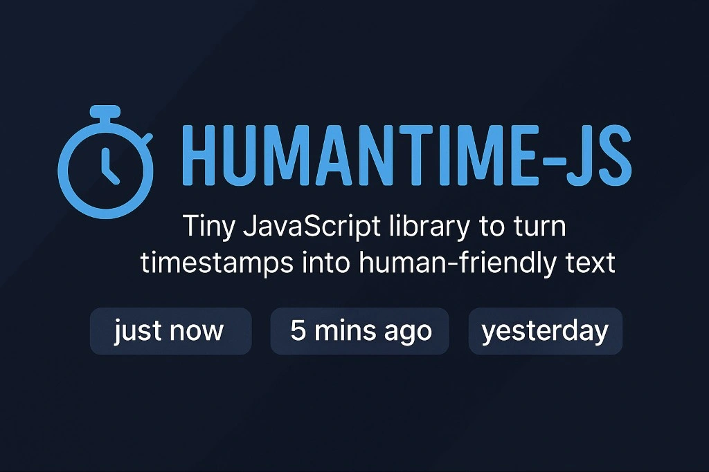

# ⏱️ humantime-js

**Turn timestamps into friendly, human-readable phrases — instantly.**

[](https://www.npmjs.com/package/humantime-js)
[](https://bundlephobia.com/result?p=humantime-js)
[](https://www.npmjs.com/package/humantime-js)
[](LICENSE)
[](package.json)
[](CONTRIBUTING.md)

*"just now"* · *"5 mins ago"* · *"yesterday"* · *"3 weeks ago"*

[Installation](#-installation) · [Usage](#-usage) · [API](#-api) · [Contributing](#-contributing)

</div>

---

## ✨ Features

| | |
|---|---|
| 🪶 **Ultra lightweight** | Under 1 KB minified — won't bloat your bundle |
| 🚫 **Zero dependencies** | Nothing extra. No surprises. |
| ⚙️ **Universal** | Works in Node.js and all modern browsers |
| 🧠 **Human-friendly** | Output your users can actually read |
| 🔌 **Plug & play** | One import, one function call |

---

## 📦 Installation

```bash
# npm
npm install humantime-js

# yarn
yarn add humantime-js

# pnpm
pnpm add humantime-js
```

---

## 🚀 Usage

```js
import { timeAgo } from 'humantime-js';

console.log(timeAgo(new Date()));                                    // "just now"
console.log(timeAgo(new Date(Date.now() - 3 * 60 * 1000)));         // "3 mins ago"
console.log(timeAgo(new Date(Date.now() - 24 * 60 * 60 * 1000)));   // "yesterday"
console.log(timeAgo(new Date(Date.now() - 7 * 24 * 60 * 60 * 1000)));// "1 week ago"
```

> 💡 **Drop it into any UI** — feeds, blogs, dashboards, comment sections — and make your timestamps feel alive.

---

## 📜 API

### `timeAgo(date: Date): string`

Takes a JavaScript `Date` object and returns a human-readable relative time string.

| Input | Output |
|---|---|
| `new Date()` | `"just now"` |
| 45 seconds ago | `"just now"` |
| 3 minutes ago | `"3 mins ago"` |
| 1 hour ago | `"1 hour ago"` |
| Yesterday | `"yesterday"` |
| 5 days ago | `"5 days ago"` |
| 2 weeks ago | `"2 weeks ago"` |
| 3 months ago | `"3 months ago"` |

---

## 🛠️ Build & Test

```bash
npm run build   # Bundle with Rollup
npm test        # Run tests with Jest
```

---

## 🤝 Contributing

[](CONTRIBUTING.md)
[](https://github.com/KelvCodes/humantime-js/issues)
[](https://github.com/KelvCodes/humantime-js/stargazers)

Contributions, bug reports, and feature requests are all welcome!

1. 🍴 Fork the repository
2. 🌿 Create a branch: `git checkout -b feature/your-feature`
3. 💾 Commit: `git commit -m "Add your feature"`
4. 🚀 Push and open a Pull Request

If this library saves you time, consider dropping a ⭐ — it helps a lot!

---

## 📄 License

[](LICENSE)

MIT © 2025 **Agyare Kelvin Yeboah**

---

## 📬 Let's Connect

Have feedback, ideas, or just want to chat? Find me here:

<div align="center">

[](mailto:onlykelvin06@gmail.com)
[](https://www.instagram.com/_.yo.kelvin/)
[](https://www.youtube.com/@TechTutor_Tv?sub_confirmation=1)
[](https://www.linkedin.com/in/kelvin-agyare-yeboah-6728a7301)
[](https://github.com/KelvCodes)

</div>

---

<div align="center">

*Because your users deserve text that feels natural — not robotic timestamps.*

</div>
